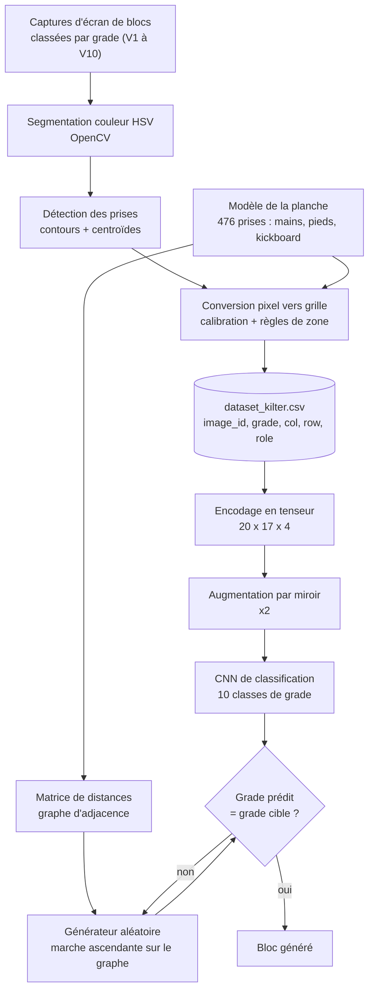
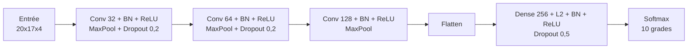

# Kilter Board : analyse et génération de blocs d'escalade par deep learning

Pipeline complet de vision par ordinateur et de deep learning appliqué à la Kilter Board, une planche d'escalade interactive : extraction de blocs depuis des captures d'écran, modélisation de la grille de prises, classification de la difficulté par CNN, puis génération de blocs validés par le modèle.

Le projet est un prototype de bout en bout. Il est documenté ci-dessous avec ses résultats, mais aussi avec ses limites, dont la principale : la génération de blocs ne modélise pas encore la cohérence des mouvements d'escalade.

---

## Sommaire

1. Contexte et objectif
2. Vue d'ensemble de la pipeline
3. Détail des étapes
4. Résultats
5. Limites connues et pistes d'amélioration
6. Installation et utilisation
7. Structure du dépôt
8. Stack technique

---

## Contexte et objectif

Sur une Kilter Board, chaque bloc est défini par un ensemble de prises allumées, chacune ayant un rôle : départ, intermédiaire, pied ou arrivée. La difficulté est exprimée en grade V (de V0 à V16 sur l'échelle américaine).

Je me suis posé deux questions :

- Peut-on prédire le grade d'un bloc à partir de la seule disposition de ses prises ?
- Peut-on s'appuyer sur ce modèle pour générer automatiquement des blocs d'un grade cible ?

Il n'existait pas de dataset prêt à l'emploi dans le format dont j'avais besoin. J'ai donc construit le mien à partir de captures d'écran numérique de blocs, ce qui a constitué une part importante du travail.

---

## Vue d'ensemble de la pipeline



La génération fonctionne par échantillonnage avec rejet : le générateur propose des blocs, le CNN les évalue, et seuls les blocs dont le grade prédit correspond à la cible sont conservés.

---

## Détail des étapes

### 1. Construction du dataset par vision par ordinateur

Les captures sont triées dans des dossiers nommés par grade (`V1`, `V2`, ..., `V10`). Pour chaque image :

- conversion en espace HSV, plus robuste que le RGB aux variations de luminosité ;
- masque de couleur par rôle de prise (vert pour le départ, cyan pour les intermédiaires, orange pour les pieds, rose pour l'arrivée) ;
- extraction des contours externes, filtrage des zones trop petites (aire inférieure à 5 pixels) et calcul du centroïde par moments d'image ;
- dédoublonnage des détections situées à moins de 15 pixels l'une de l'autre.

La conversion des coordonnées pixel vers coordonnées de grille utilise une calibration linéaire (décalage et échelle sur chaque axe, plus une correction globale sur l'axe vertical), puis applique les règles propres à la géométrie de la planche :

|Zone|Axe X|Axe Y|
|---|---|---|
|Kickboard (bas de la planche)|colonnes décalées de 0,5|lignes entières|
|Mur principal, mains|colonnes entières|lignes entières|
|Mur principal, pieds|colonnes entières|lignes décalées de 0,5|

Sortie : `dataset_kilter.csv`, une ligne par prise, avec les colonnes `image_id`, `grade`, `col`, `row`, `role`.

### 2. Modélisation de la planche

La grille est reconstruite de façon programmatique pour valider visuellement l'extraction et pour servir de base au générateur :

- **Kickboard** : 2 rangées (lignes -2 et -1), la première décalée d'une demi-colonne ;
- **Mur principal** : 18 rangées par 17 colonnes de prises pour les mains ;
- **Pieds intermédiaires** : vis positionnées entre les prises principales, selon un motif en damier.

Au total, la planche modélisée compte 476 prises, chacune identifiée par un identifiant normalisé (par exemple `h_80_80` pour une prise main en (8,0 ; 8,0)). Une matrice de distances euclidiennes (`scipy.spatial.distance.pdist`) permet ensuite d'interroger le voisinage de n'importe quelle prise.

### 3. Encodage en tenseur

Chaque bloc est représenté comme une image à quatre canaux, de dimension 20 x 17 x 4 :

|Canal|Contenu|
|---|---|
|0|prises de départ|
|1|prises intermédiaires|
|2|pieds|
|3|prise d'arrivée|

Le dataset final contient 13 431 blocs répartis sur 10 grades (V1 à V10). Pour que les lignes de la grille (de -2 à 17) deviennent des indices positifs, un décalage de +2 est appliqué ; les positions en demi-colonne du kickboard sont tronquées à l'entier inférieur.

Des cartes de chaleur globales (toutes prises, puis mains et pieds séparément) permettent de vérifier que la distribution spatiale des prises extraites est cohérente avec la planche réelle.

### 4. Classification de la difficulté par CNN

**Augmentation de données.** La planche étant globalement symétrique, chaque bloc est dupliqué par symétrie horizontale, ce qui double le dataset (26 862 exemples). Séparation 80 % entraînement, 20 % test.

**Architecture.**



**Entraînement.** Optimiseur Adam (taux d'apprentissage 5e-4), perte `sparse_categorical_crossentropy`, avec `EarlyStopping` (patience de 5 sur la perte de validation, restauration des meilleurs poids) et `ReduceLROnPlateau`. L'entraînement s'est arrêté de lui-même à la 21e époque.

### 5. Génération de blocs par grade cible

Le générateur procède en trois temps :

1. **Départ** : une ou deux prises de départ choisies dans les premières rangées, accompagnées de pieds sur le kickboard à proximité.
2. **Progression** : marche aléatoire ascendante sur le graphe d'adjacence des prises mains (distance maximale de 4 unités entre deux prises consécutives), jusqu'à atteindre le haut de la planche.
3. **Pieds** : ajout de pieds de support autour de chaque prise main, choisis aléatoirement entre vis et prises principales.

Chaque bloc candidat est converti en tenseur et soumis au CNN. La boucle s'arrête dès que le grade prédit correspond au grade demandé, avec un nombre d'essais maximal configurable.

Exemple d'exécution pour une cible V6 : bloc trouvé dès le premier essai, en 0,12 seconde.

---

## Résultats

Évaluation sur l'ensemble de test (20 % du dataset augmenté) :

|Métrique|Valeur|Référence aléatoire (10 classes)|
|---|---|---|
|Précision exacte|environ 36 %|10 %|
|Précision à plus ou moins 1 grade|76,2 %|28 %|

Lecture des résultats : la difficulté d'un bloc est une grandeur en partie subjective, et les grades voisins sont difficiles à distinguer même pour des grimpeurs. Le modèle se trompe rarement de plus d'un grade, ce qui suggère qu'il capte une information réelle sur la structure des blocs (hauteur, écartement des prises, répartition des pieds), sans atteindre la finesse d'un grade exact. Une matrice de confusion est produite dans le notebook pour analyser les confusions entre grades.

---

## Limites connues et pistes d'amélioration

**Cohérence des mouvements.** C'est la limite principale. Le générateur ne connaît que la distance entre prises : il n'a aucune notion de ce qui constitue un enchaînement naturel (alternance main gauche et main droite, placement réaliste des pieds, équilibre du corps). Il peut donc produire des blocs valides pour le CNN mais absurdes pour un grimpeur. Le CNN joue le rôle de juge de difficulté, pas de juge de qualité.

**Pistes pour y répondre :**

- modéliser les mouvements de manière explicite (contraintes d'écartement bras et jambes, règles d'alternance) ;
- remplacer la marche aléatoire par un modèle génératif entraîné sur les blocs réels (autoencodeur variationnel, ou modèle séquentiel sur la suite de prises) ;
- ajouter un second critère d'acceptation, par exemple un classifieur "bloc réaliste ou non" entraîné contre des blocs aléatoires.

**Évaluation.** L'augmentation par miroir est appliquée avant la séparation entraînement et test : un bloc et son symétrique peuvent se retrouver de part et d'autre de la séparation, ce qui peut gonfler légèrement les métriques. Une séparation par bloc d'origine avant augmentation serait plus rigoureuse.

**Conversion pixel vers grille.** L'extraction repose sur une calibration manuelle et sur des seuils de couleur ; le placement des pieds est la partie la plus sensible, car ils alternent entre positions entières et demi-positions selon la zone de la planche.

**Représentation.** Les demi-positions des pieds sont tronquées pour tenir dans une grille entière. Une grille de résolution double conserverait cette information.

---

## Installation et utilisation

```bash
git clone <url-du-depot>
cd <nom-du-depot>

python -m venv .venv
source .venv/bin/activate        # Windows : .venv\Scripts\activate
pip install opencv-python numpy pandas matplotlib seaborn scipy scikit-learn tensorflow jupyter

jupyter notebook Kilterboard.ipynb
```

Le notebook s'exécute dans l'ordre des cellules :

1. extraction des prises depuis les captures et écriture du CSV ;
2. visualisation d'un bloc extrait sur la grille modélisée ;
3. construction du DataFrame de la planche et de la matrice de distances ;
4. génération aléatoire d'un bloc ;
5. encodage en tenseurs `X_kilter_tensor.npy` et `y_kilter_labels.npy` ;
6. cartes de chaleur d'utilisation des prises ;
7. entraînement et évaluation du CNN ;
8. génération d'un bloc pour un grade cible.

Le dossier `Dataset/` (captures de blocs triées par grade, un sous-dossier par grade) est attendu à la racine du projet pour l'étape 1.

---

## Structure du dépôt

```
.
├── Kilterboard.ipynb        Notebook principal : toute la pipeline
├── README.md
└── (fichiers produits à l'exécution)
    ├── dataset_kilter.csv       Prises extraites, une ligne par prise
    ├── X_kilter_tensor.npy      Tenseurs des blocs (N, 20, 17, 4)
    ├── y_kilter_labels.npy      Labels de grade
    └── grade_mapping.csv        Correspondance grade vers identifiant de classe
```

---

## Stack technique

|Domaine|Outils|
|---|---|
|Vision par ordinateur|OpenCV (segmentation HSV, contours, moments)|
|Données|NumPy, pandas, SciPy|
|Deep learning|TensorFlow / Keras|
|Évaluation|scikit-learn, Seaborn, Matplotlib|
|Environnement|Python, Jupyter|

---

## Auteur

Simon, étudiant ingénieur.